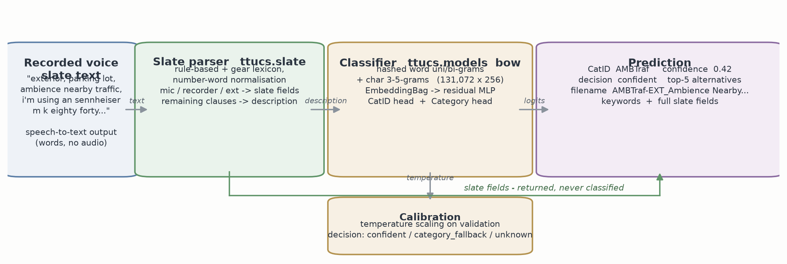

# ttucs: Text to UCS

ttucs turns spoken field-recording slates (speech-to-text output) into
[Universal Category System](https://universalcategorysystem.com/) metadata. For each slate it returns a
CatID, Category/SubCategory, a confidence, the parsed slate fields, a suggested UCS filename, and
keywords. It is built with PyTorch and MLflow, and inference runs locally and offline.

```bash
pip install ttucs          # also installs the pretrained weights (ttucs-model-bow, ~63 MB)
```

```python
import ttucs as t

p = t.predict("Project Thick As Thieves, location Squamish forest, recording a wooden door creak slow, "
              "Sennheiser MKH 416 and Sound Devices MixPre, 96k 24 bit, take 3")
p.cat_id, p.category_full, p.confidence
p.filename                        # e.g. 'DOORCreak_Wooden Door Creak Slow_NONE_ThickAsThieves_MKH416'
p.slate["sample_rate"], p.slate["take"]
p.to_json()

# The first t.predict() call loads the installed weights offline and reuses them.
# For a specific model directory or inference overrides, use the class API:
from ttucs import TTUCS
model = TTUCS.from_pretrained("models/my-model")
```

Only the parsed **description** goes to the classifier. The other slate fields are returned but are
never used for classification.

## How it works



Regenerate with `python scripts/render_architecture.py` (needs `pip install matplotlib`).

**Step by step, from spoken slate to finished UCS metadata:**

1. **Transcript in** — a voice recorder or dictation app turns the spoken slate into plain text.
   Spoken numbers and letters arrive mangled ("m k eighty forty", "ninety six k"); ttucs works from
   this raw STT text, never audio.
2. **Normalise** — `ttucs.slate.normalize` repairs STT quirks: number words become digits
   ("ninety six k" → "96 k"), dropped letters are restored ("m k eighty forty" → "mk 8040"),
   filler words are dropped.
3. **Parse** — `ttucs.slate.parse_slate` runs rule-based patterns plus the gear lexicon over the
   normalised text. Gear ("sennheiser mkh 416" → `Sennheiser MKH 416`, "dual a b" →
   `Spaced Pair (AB)`), recorder, sample rate, take, scene, perspective (EXT/INT), project,
   location and date are lifted into typed slate fields. Everything left over is treated as a
   description clause; perspective-only words and stray mic-brand fragments are kept out of it.
4. **Assemble the description** — description clauses are joined (an explicit "recording …" cue
   absorbs the content clauses that follow it; without a cue, all content clauses join), e.g.
   "ambience nearby traffic in metrotown area, crossing sign, children playing in a nearby park, wind".
5. **Classify** — the description only (slate fields never reach the model) is hashed into word
   uni/bi-grams and char 3–5-grams over 131,072 buckets, averaged by the EmbeddingBag, passed
   through a small residual MLP, and scored by both heads: 738 trainable UCS CatIDs across 81
   categories (753 total, ARCHIVED workflow category excluded).
6. **Calibrate + decide** — logits are temperature-scaled (fitted on validation data) into
   probabilities; the decision rule labels the result `confident`, `category_fallback` (sure of
   the category but not the CatID → the category's MISC CatID) or `unknown`.
7. **Build the outputs** — ttucs returns the CatID, calibrated confidence, top-k alternatives and
   category scores, the full slate fields, suggested UCS keywords, and a UCS-conformant filename
   like `AMBTraf-EXT_Ambience Nearby Traffic_JEAud_AmbMetro_CMC41` (CatID_FX Name_CreatorID_
   SourceID[_UserData]) — ready to paste into Soundminer, BaseHead or your own library tool.

## Install

| what | command |
|---|---|
| inference (API + `ttucs predict/parse/info/download`) | `pip install ttucs` |
| training, evaluation, reports, MLflow | `pip install "ttucs[train]"` |
| MiniLM encoder model | `pip install "ttucs[transformers]"` |
| development | `pip install -e packages/ttucs-model-bow -e ".[dev]"` |

PyTorch is required. On machines without a GPU, install the much smaller CPU-only wheel first:
`pip install torch --index-url https://download.pytorch.org/whl/cpu`.

## Weights and offline use

The weights ship as a separate, data-only distribution,
[`ttucs-model-bow`](https://github.com/SoundsLikeJonny/ttucs/tree/main/packages/ttucs-model-bow).
`ttucs` depends on it, so `pip install ttucs` fetches it automatically. Wheels can't run code at install
time, which is why the weights are their own package. After installation nothing touches the network.

`TTUCS.from_pretrained()` (or `from_pretrained("bow")`) looks for a model in this order:

1. an explicit local directory: `TTUCS.from_pretrained("models/my-model")`;
2. the installed `ttucs_model_bow` package;
3. the user cache: `$TTUCS_HOME`, or the platform cache dir (e.g. `~/.cache/ttucs`), filled by `ttucs download`;
4. a SHA-256-verified download of the
   [GitHub Release asset](https://github.com/SoundsLikeJonny/ttucs/releases), **only** when offline mode is off.

Set `TTUCS_OFFLINE=1` (`HF_HUB_OFFLINE=1` is honoured too) to guarantee no network access. If no weights
are found, the error lists exactly what to install or run.

```bash
ttucs info [--verify]        # resolved model path/source, versions, offline mode (and sha256 check)
ttucs download --model bow   # fill the cache, e.g. for air-gapped images (--dest DIR, --url MIRROR --sha256 HEX)
```

`from_mlflow("models:/ttucs/1")` still loads models from an MLflow registry (needs `[train]` or `[mlflow]`).

## CLI

```bash
ttucs predict "glass bottle smash on concrete, exterior, take two"   # --json, -k 5, --file slates.txt
ttucs parse "project nightfall, location tofino beach, waves on rocks, ninety six k, take one"
ttucs generate-data -c configs/bow-release.yaml                       # [train]
ttucs train -c configs/bow-release.yaml                               # [train]; MLflow optional
ttucs eval -m models/ttucs-bow-release                                # [train]
ttucs report -c configs/bow-release.yaml                              # [train]
```

The API also offers `t.predict_batch` / `predict_batch`, `top_k`, aggregated category scores,
temperature calibration, a `decision` field (`confident` / `category_fallback` to the category's
MISC CatID / `unknown`), and `save_pretrained`. The parser feeds the classifier the full
description: on slates without a "recording ..." cue it joins all content clauses, so multi-part
ambience slates ("nearby traffic, crossing sign, children playing in a nearby park, wind") are
classified in whole.

## Models

| config | model | notes |
|---|---|---|
| `configs/bow-release.yaml` | hashed word+char n-gram bag of embeddings (131,072 × 256), CatID + Category heads | **published weights** (fp16 safetensors, ~68 MB); CPU; ~3 min training |
| `configs/bow.yaml` | the same, larger (524,288 × 192) | ~400 MB fp32; no accuracy gain on synthetic data (see model card) |
| `configs/minilm.yaml` | frozen all-MiniLM-L6-v2 + MLP head | optional, needs `[transformers]` (**not trained/verified yet**) |
| `configs/zeroshot.yaml` | TF-IDF similarity to UCS Explanation+Synonyms | cold-start floor, no training |

Training-data and featurisation knobs for experimentation (all defaults off): `data.synthetic.multi_clause_prob`
(join same-class description pairs, 0.2 in the release config), `data.synthetic.verbose_prob` (longer
action-narration / scene-observation styles), `model.head_repeat` (repeat the first clause's features in the
bag mean). See `CHANGELOG.md` for what helped and what did not in controlled rounds.

## Results: published model (`ttucs-model-bow` 0.2.0, fp16)

| test split | n | top-1 | top-5 | macro-F1 | ECE |
|---|---:|---:|---:|---:|---:|
| synthetic descriptions | 22,384 | 0.908 | 0.983 | 0.904 | 0.020 |
| synthetic spoken slates (parser → model) | 2,000 | 0.900 | 0.976 | 0.884 | 0.023 |
| hand-written dev descriptions (tuning set) | 332 | 0.789 | 0.925 | 0.788 | 0.069 |
| **hand-written realistic slates (held out)** | 80 | **0.713** | **0.925** | 0.723 | 0.138 |

The fp16 export matches the fp32 checkpoint to within 0.0001 on every split. The previous weights
(0.1.1) scored 0.488 top-1 / 0.813 top-5 on the realistic slates.

**Read these numbers with caution.** The synthetic test sets come from the same generator as the
training data and overstate real-world accuracy. The 80 hand-written slates are the most honest signal:
about seven in ten are right at top-1 and over nine in ten are in the top 5. The set is tiny (one slate
is 1.25 points), and confidence is still over-optimistic on real phrasing (ECE 0.14). Part of the gain
comes from a hand-written phrase bank, and some everyday wording in it also appears in these slates;
on the 29 slates that share no bank phrase with their own class, top-1 went from 0.552 to 0.724. The
model is trained only on redistributable data (synthetic text plus UCS label documents). Training on
your own labelled library metadata is the most promising way to improve further; it is on the roadmap
and not yet a built-in option. See
[MODEL_CARD.md](https://github.com/SoundsLikeJonny/ttucs/blob/main/MODEL_CARD.md) and
[DATA_CARD.md](https://github.com/SoundsLikeJonny/ttucs/blob/main/DATA_CARD.md).

## Roadmap
- Fine-tune on your own labelled library metadata (Soundminer/BaseHead exports) and real slate recordings.
- Speech-to-text integration (e.g. Whisper) with word timestamps → slate-to-region alignment.
- Active learning: log low-confidence predictions and user corrections, then retrain.
- Train and evaluate the MiniLM path; consider a learned slate parser (token tagging).

## Releasing
See [docs/RELEASING.md](https://github.com/SoundsLikeJonny/ttucs/blob/main/docs/RELEASING.md)
(Trusted Publishing to TestPyPI/PyPI, model release assets) and the
[CHANGELOG](https://github.com/SoundsLikeJonny/ttucs/blob/main/CHANGELOG.md).

## Credits & license
Code and published weights: MIT (c) 2025 Jon Evans. The UCS category list v8.2.1 is by Tim Nielsen,
Justin Drury, Kai Paquin and contributors, a public-domain initiative
(<https://universalcategorysystem.com/>).
