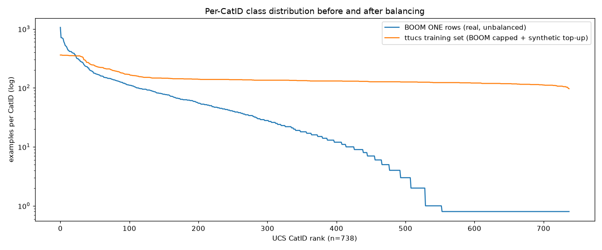
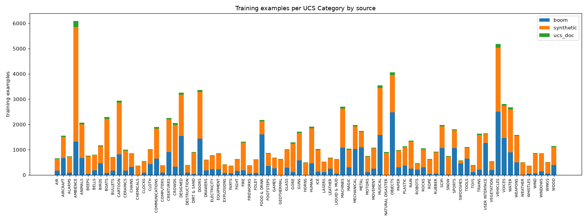

# Class distribution report

UCS v8.2.1: 753 CatIDs, 738 trainable (excluded categories: ARCHIVED).

## BOOM ONE (real metadata)

- rows with a valid UCS CatID: 40325
- trainable CatIDs covered: 553 / 738; missing: 185
- rows per covered CatID: median 34, mean 72.9, max 1063 (OBJCont)
- unique prose descriptions (after keyword-tail removal): 25786

Missing CatIDs per category (top 15): BOATS 14, AMBIENCE 12, MUSICAL 9, CARTOON 6, TRAINS 6, VEHICLES 6, DESIGNED 5, DOORS 5, GEOTHERMAL 5, HUMAN 5, NATURAL DISASTER 5, CREATURES 4, DIRT & SAND 4, ICE 4, MACHINES 4

Top-10 dominant CatIDs: OBJCont 1063, FEETHmn 711, VEHMech 708, MACHAppl 699, TOOLPowr 682, MUSCPerc 608, METLImpt 572, METLFric 524, FOODTware 513, CLOTHMvmt 498

## Balanced training set

| source | examples | CatIDs |
|---|---:|---:|
| boom | 36827 | 539 |
| synthetic | 68973 | 738 |
| ucs_doc | 3305 | 738 |

- examples per CatID: min 97, median 131, max 361; imbalance ratio max/min 3.7

